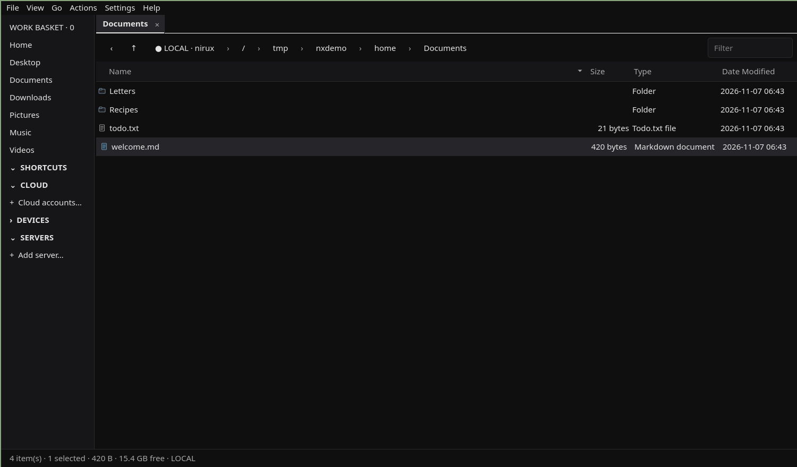

# NIRUORG

Keyboard-friendly two-pane file organizer for local folders, servers and cloud remotes.

**Status: beta** · Part of the [NIRUX](https://github.com/nirucon/nirux) suite · [MIT License](LICENSE)



## About

NIRUORG is my file manager: two panes, tabs, a command palette and safe
copy/move between local folders, Nextcloud, SSH/SFTP, FTP/FTPS and rclone
remotes. It is written in Python with PySide6 (Qt 6).

It is a NIRU app first and a NIRUX extra second. It follows the NIRUX theme
live when NIRUX is installed, but it is a normal Qt application and also runs
on other desktops, including Wayland ones such as Omarchy/Hyprland, where it
was originally developed.

Transfers are designed to be predictable rather than clever: copies go to a
temporary partial file first, a partial is only resumed after its bytes are
verified against the source, and a move deletes the source only after the
destination is complete. A remote-to-remote transfer passes through this
computer; it is not a server-side copy.

## Features

- Two independent panes, per-pane tabs with restore, readable breadcrumbs,
  type-ahead find and keyboard navigation.
- Local files, Nextcloud sync folders, SSH/SFTP through SSHFS, FTP/FTPS and
  cloud remotes through rclone.
- Drag and drop between panes (copy by default), explicit Move, conflict
  decisions, cancel, an operation queue and history, and undo of a transfer.
- Resume of interrupted copies from *verified* partial data only.
- Work Basket for collecting file references from different places;
  Workspaces and Collections for saved workflows.
- Compare two locations; any transfer stays an explicit decision (no automatic
  destructive synchronization).
- Search, filter, Quick Look/preview, image gallery and slideshow, archives,
  duplicate finder, checksums, custom actions and recipes, atomic bulk rename.
- Nextcloud share links with expiry, password and permissions.
- Large folders list incrementally: 100 000 local entries show their first
  rows in about 30 ms and are complete in about 1.2 s.
- Themes: **Follow NIRUX** (live), Follow Omarchy, Niru Noir, C. Larsson,
  Satie, Nord and System.

## Requirements

- Linux with Python 3 and PySide6. Developed on Arch (Omarchy/Hyprland) and
  used on Debian and on X11 with NIRUX.
- The installer can install the core dependencies with `pacman` (Arch),
  `xbps-install` (Void, since 0.6.1) or `apt-get` (Debian).
- Optional integrations, used only when present: `sshfs`, `rclone`, `fuse3`,
  `mpv`, `ffmpeg`, `fd`, `ripgrep`, `7z`, `zip`/`unzip`, `bsdtar`
  (libarchive) and `secret-tool` (libsecret) for remembered secrets.

## Installation

### With NIRUX

NIRUORG is an optional extra. It is not installed by a normal `nirux install`:

```sh
nirux extras install niruorg
nirux extras update            # later: update selected extras to the pinned version
```

NIRUX downloads the pinned release tag, verifies its SHA-256 and runs the
project's own `install.sh`.

### Standalone

Download the release ZIP (or clone the repository), then:

```sh
./install.sh
```

The installer stages the release under `~/.local/share/niruorg/releases/`,
compiles the sources, runs the regression suite, `--self-test` and an
offscreen Qt smoke test, and **only then** switches the `current` symlink.
Earlier releases stay on disk and existing settings, connections, Work Basket
and workspaces are kept. It never replaces the active release in place;
running it again for the same version only restores the launcher, desktop
entry and icon.

The installer may use `sudo` for **missing core dependencies** (Python 3 and
PySide6, with pacman, xbps-install or apt-get). Without a terminal it cannot
answer the package manager's question; `./install.sh --yes` installs them
without asking. Optional
integrations are only installed when you ask for them:

```sh
NIRUORG_INSTALL_OPTIONAL=1 ./install.sh
```

To try the source without installing, run `./run.sh` in a desktop session with
PySide6 installed. More detail: [docs/INSTALL.md](docs/INSTALL.md).

## Usage

Start it with `niruorg` (or `niruorg PATH` to open a folder).

```sh
niruorg --version
niruorg --self-test
```

A typical session:

1. Open a folder in the left pane and a destination (local, server or cloud)
   in the right pane.
2. Drag files across to **copy**, or use **Move** from Actions.
3. Watch the transfer strip at the bottom; existing names ask for a decision.
4. Use the **Work Basket** to collect files from different folders without
   moving the originals.
5. Use **Compare panes** for an overview; transfers remain your decision.

Most used keys:

| Key | Action |
|---|---|
| `Ctrl+T` / `Ctrl+W` | New tab / close tab |
| `Ctrl+Shift+T` | Reopen closed tab |
| `Ctrl+K` | Command palette |
| `Ctrl+L` | Type a location |
| `Ctrl+F` / `/` | Find files and content / filter the current folder |
| `Ctrl+1` … `Ctrl+4` | List, Split, Gallery, Smart view |
| `F3` / `Space` | Quick Look / Inspector |
| `Ctrl+Shift+Right` | Send selection to the other pane |
| `Ctrl+Shift+M` | Compare panes |
| `Ctrl+D` | Work Basket |
| `Ctrl+Alt+T` | Terminal in the current folder |
| `Ctrl+H` | Hidden files |
| `Ctrl+Z` | Undo transfer |

The full list is in [docs/KEYBINDINGS.md](docs/KEYBINDINGS.md) and under
**Help → Keybindings** in the app. Closing the window normally (for example
`Super+Q` in Hyprland) unmounts the mounts NIRUORG created; a forced kill
cannot run that cleanup.

## Configuration

Everything is configured in the app (**Settings**): theme, terminal and shell
(defaults: `kitty` or `x-terminal-emulator`, and `fish` or `bash`), servers,
cloud accounts, actions and recipes. Custom actions run as an argument list
without a shell; placeholders are `{files}`, `{file}`, `{name}`, `{stem}` and
`{dir}`.

With **Follow NIRUX** the palette is read from the NIRUX theme files
(`~/.config/niruwm/appearance.toml`, `~/.config/niruwm/config.toml`,
`~/.config/nirux/theme/kitty.conf`) and changes are picked up live. Follow
NIRUX is the default when NIRUX is installed, Niru Noir otherwise.

## Files and paths

| Path | Purpose |
|---|---|
| `~/.local/bin/niruorg` | Launcher |
| `~/.local/share/niruorg/releases/VERSION/` | Installed releases |
| `~/.local/share/niruorg/current` | Symlink to the active release |
| `~/.local/state/niruorg/` | Logs (`launcher.log`) and runtime state, including `owned-mounts.json` |
| `~/.config/NIRU/NIRUORG.conf` | Preferences (Qt `QSettings`, organization `NIRU`) |
| `~/Nextcloud/Backup/niruorg/servers.json` | Portable server definitions when that synced folder exists |
| `~/.config/niruorg/servers.json` | Server definitions otherwise |

Passwords are kept for the session only by default. Remembered secrets go to
the Linux Secret Service; SSH agents/keys and rclone keep their own
credentials. Only mounts NIRUORG created are treated as its own and unmounted
automatically. Never commit SSH keys, rclone configuration, settings, crash
dumps or transfer logs to this repository.

## Troubleshooting

- **A remote folder hangs or shows nothing.** SSHFS/rclone mounts can stop
  responding while still appearing in the mount table. NIRUORG explains
  disconnected and unresponsive mounts in the pane; reconnect, or unmount the
  stale mount by hand.
- **Leftover `.niruorg-part` files.** An interrupted copy keeps its partial for
  a later verified resume. Inspect or delete it before retrying elsewhere.
- **Selecting everything in a huge folder is slow.** `Ctrl+A` in a folder with
  100 000 entries takes about 1.5 s; this is a known limit.
- **Help → System diagnostics** gives a report without passwords, tokens or
  keys, useful when something misbehaves. The launcher log is
  `~/.local/state/niruorg/launcher.log`.
- **An upgrade went wrong.** Check `readlink -f ~/.local/share/niruorg/current`
  and roll back:

  ```sh
  ./rollback.sh --list
  ./rollback.sh 0.5.1
  ```

  Rollback only switches the active release symlink after a version check; it
  keeps data, connections and newer releases.

## Uninstall

```sh
./uninstall.sh
```

With NIRUX: `nirux extras uninstall niruorg`. This removes the launcher, desktop entry and icon only. Settings, logs,
release directories and mounts are kept on purpose; inspect them before
removing anything by hand.

## Building from source

There is nothing to compile. Checks, run from the repository root:

```sh
python3 -m compileall -q niruorg
python3 regression-suite.py --non-qt                  # no Qt or display needed
QT_QPA_PLATFORM=offscreen python3 regression-suite.py # full suite, needs PySide6
python3 niruorg/app.py --self-test
```

See [docs/TESTING.md](docs/TESTING.md), [docs/ARCHITECTURE.md](docs/ARCHITECTURE.md)
and [CONTRIBUTING.md](CONTRIBUTING.md). Changes per release are in
[CHANGELOG.md](CHANGELOG.md) and [RELEASE_NOTES.md](RELEASE_NOTES.md).

## Status, disclaimer and how it's made

**Status: beta.** Local, server and cloud browsing and the safe transfer path are solid and covered by tests. Live SSHFS/rclone failure handling, Nextcloud and Wayland drag and drop still need more real-world testing, and the main window code is due for further splitting.

NIRUX and every niru* project are made by me, Nicklas Rudolfsson
([@nirucon](https://github.com/nirucon)), for me. They are tailored to my own
needs, preferences and workflows, on my own machines. If they fit yours too,
that's a nice bonus.

- **Free and open source.** Anyone is free to use, study, change and share
  it under the [MIT License](LICENSE).
- **No guarantees.** There is no warranty of any kind. Use it at your own
  risk, read what you install and keep backups of anything that matters.
- **How it's made.** Some of these projects I built from scratch by hand. In
  more recent releases I have used Claude, Anthropic's AI, to do much of the
  heavy lifting under my direction: I decide what to build and how it should
  behave, and I test it on my own machines. It saves me a lot of time, and
  the result is quite OK.
- **Alpha, beta, dev, and maybe forever.** Most things here are alpha, beta
  or dev, and may stay that way. Maybe one day there will be a real stable
  release, but given how fast development moves, and how I am as a person,
  maybe never :)

| Label | Meaning |
|---|---|
| dev | Under active construction; may not build, install or work yet. |
| alpha | Works on my machines, but incomplete or rough; expect breaking changes. |
| beta | In daily use on my machines and mostly complete; rough edges remain. |

## License

MIT License, see [LICENSE](LICENSE). Copyright (c) 2026 Ing Leif Nicklas Rudolfsson.
